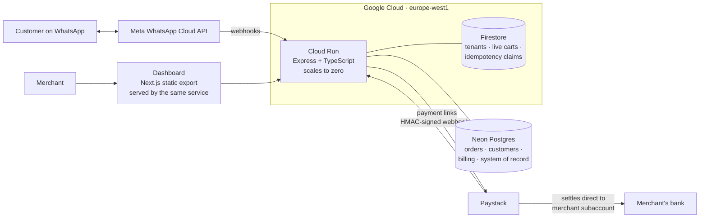

# Chatly: WhatsApp commerce for South African small businesses

**Chatly** is a multi-tenant conversational-commerce platform. A merchant connects their own WhatsApp number; Chatly runs an ordering and quoting conversation on it, takes payment through the merchant's own payment account, records the sale, and gives the merchant a dashboard over all of it.

Designed, built and run by [Ntsika Gqiba](https://www.linkedin.com/in/ntsika-gqiba) under Vularis (Pty) Ltd. **In active development; founder-cohort stage.** This repo documents architecture and decisions; the source is private.

---

## Why it exists

South African service and trades businesses quote, sell and get paid inside WhatsApp, by hand. Quotes are typed out, payment details are sent as screenshots, and nobody can see what was sold. Chatly turns that chat into a system: catalogue, cart, PDF quotes, payment links and a record of every sale, without the merchant leaving WhatsApp.

## Architecture

| Layer | Choice |
|---|---|
| Runtime | One Cloud Run service (Node.js, Express, TypeScript), three hostnames via domain mappings |
| Messaging | WhatsApp Cloud API, integrated directly as an **Independent Tech Provider** (no reseller) |
| Payments | Paystack behind a provider abstraction, so the processor is swappable |
| Hot-path data | Firestore: tenant credentials, live conversation state, inbound-message idempotency |
| System of record | Neon Postgres: orders, customers, organisations, billing; plain-SQL idempotent migrations |
| Dashboard | Next.js static export served from the same origin as the API (no second server, no CORS) |
| Marketing site | React + Vite, statically prerendered for SEO, on Vercel |

## Design decisions worth explaining

The project has **25+ Architecture Decision Records**. The ones that shape the system:

**Two datastores, split by access pattern.** The WhatsApp webhook path needs low-latency keyed reads and writes (live cart, "have I seen this message?"), so that's Firestore. The dashboard needs joins, filters and aggregates, so that's Postgres. The long-term plan is to collapse to Postgres only.

**One money chokepoint.** Every customer payment (chat checkout, a freeform `PAY 150`, a dashboard payment link, a PDF quote, a POS QR code) goes through one function. It refuses to create a link unless the merchant has their own Paystack subaccount. Without that, a charge could silently settle to the platform account.

**Chatly never holds merchant money.** Funds settle straight to the merchant's bank through their Paystack subaccount. Chatly is never merchant-of-record; its fee is taken on top as the subaccount charge.

**Orders are written only by the payment webhook**, only as `paid` or `failed`, and never as speculative "pending" rows. Revenue and customer-value stats read straight off the orders table, so it has to be true. Unpaid links are tracked separately. The money-critical write happens first; confirmations, PDF receipts and loyalty points are best-effort and can never fail the webhook.

**Idempotency across scale-out.** Cloud Run can run several instances. Inbound WhatsApp messages are claimed with a Firestore `create()`, which fails if the document already exists, so two instances racing on the same message is safe. Payments are idempotent on the payment reference.

**A deterministic state machine, not an LLM.** The conversation engine is keyword- and tap-driven. Each timeout exists because production showed a customer could otherwise get stuck: cart expiry, payment-link expiry, human handoff, quiet period after payment. Message lists respect Meta's 10-row limit, with paging and empty states.

**Multi-tenant authorisation in one place.** Organisation → merchants (WhatsApp numbers) → members with roles (owner / admin / staff). Every route declares the capability it needs; a single capability map decides. Route handlers never check roles themselves.

**Payment before the hardest step.** Self-serve signup takes the subscription payment *before* Meta's Embedded Signup, which is the step with the highest drop-off. Merchants keep their existing number on the WhatsApp Business app (coexistence), which the target market requires.

**Europe, on purpose.** Cloud Run and Firestore are in `europe-west1`, close to Meta's Cloud API, and Postgres is in Frankfurt.

## Milestones

- Approved through **Meta App Review** for WhatsApp Business messaging and management.
- **Paystack** verified; the quote-to-payment flow is proven end to end with a live transaction (PDF quote and payment link delivered in WhatsApp, money settled, order recorded).
- Two onboarding paths: self-serve and founder-led concierge.

## Honest status

What's deliberately not done yet, and on the roadmap:

- **No automated test suite.** Verification is manual for now.
- **No scheduler.** Cloud Run scales to zero, so time-based automations (reminders, trial expiry) need Cloud Scheduler.
- **Secrets move to Secret Manager** before the wider launch.
- **Observability** is Cloud Logging plus email alerts; metrics, dashboards and uptime checks are next.

---

*Want to see it in action or talk architecture? [Reach out on LinkedIn](https://www.linkedin.com/in/ntsika-gqiba).*
